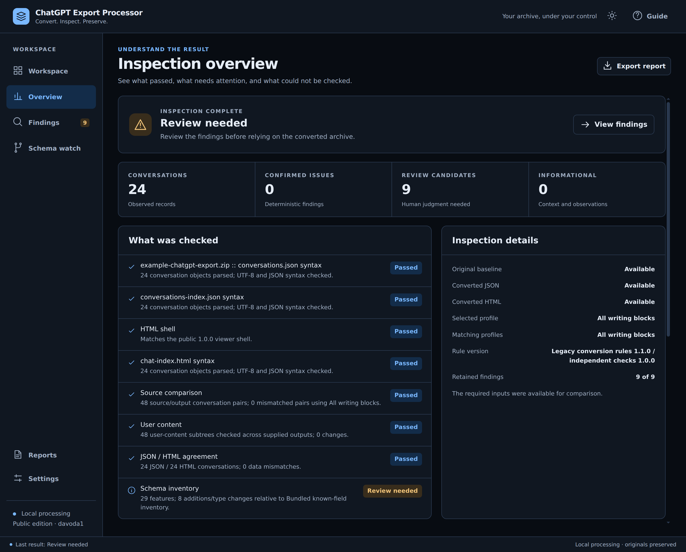
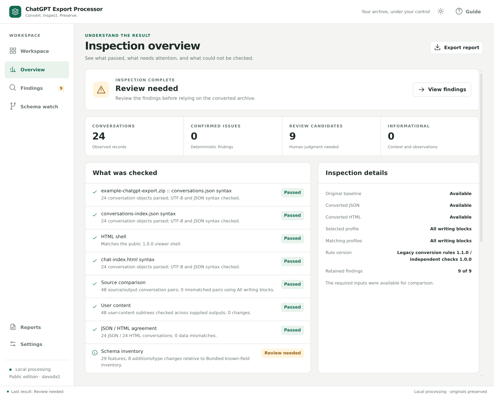
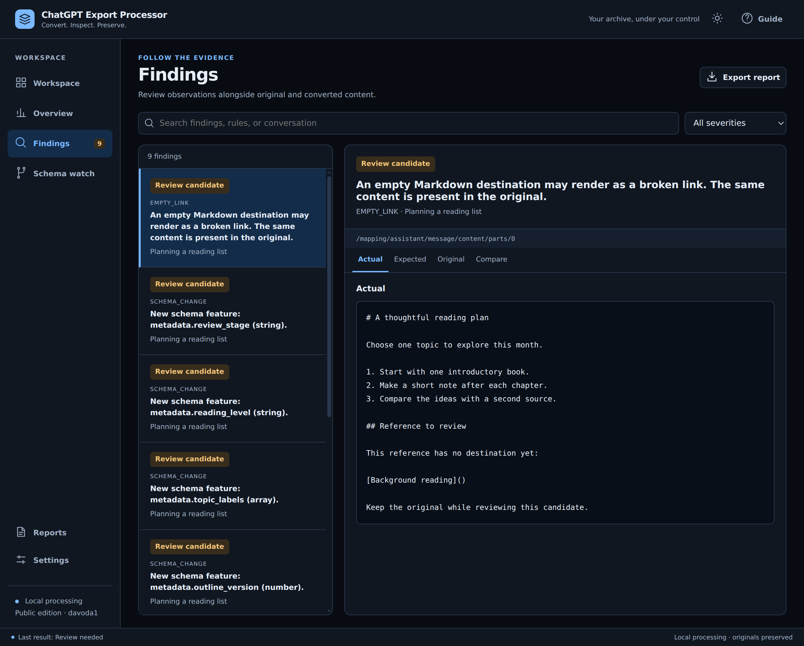
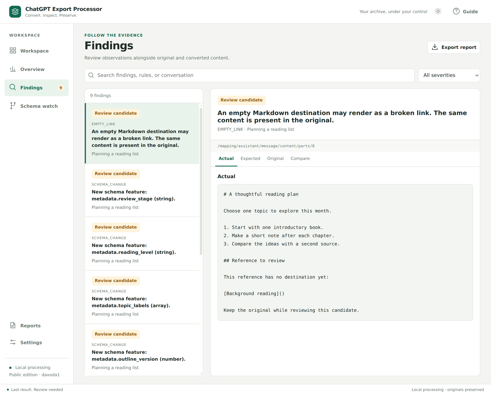
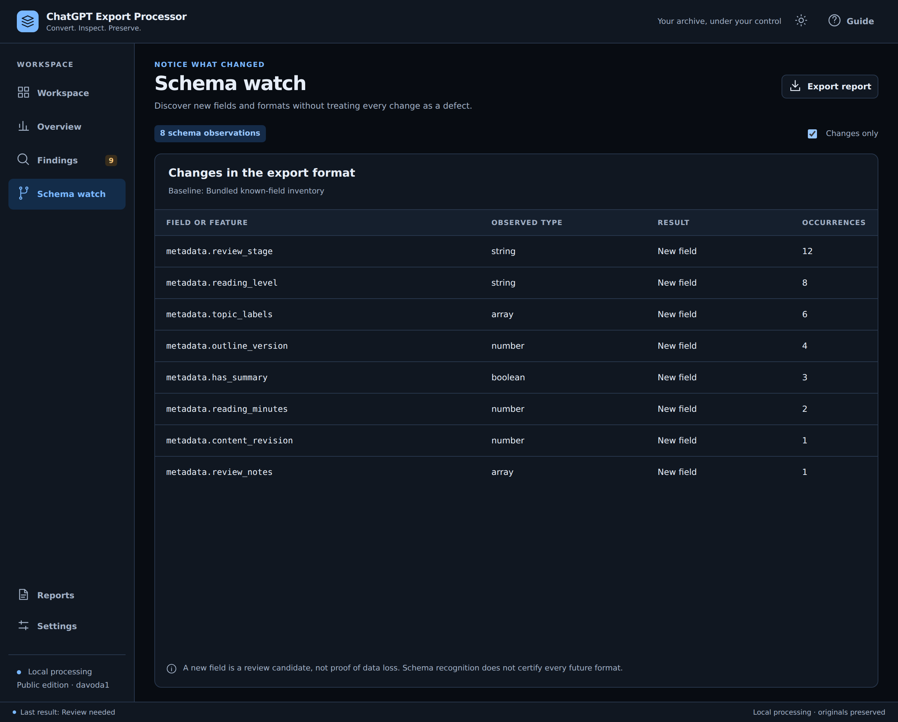
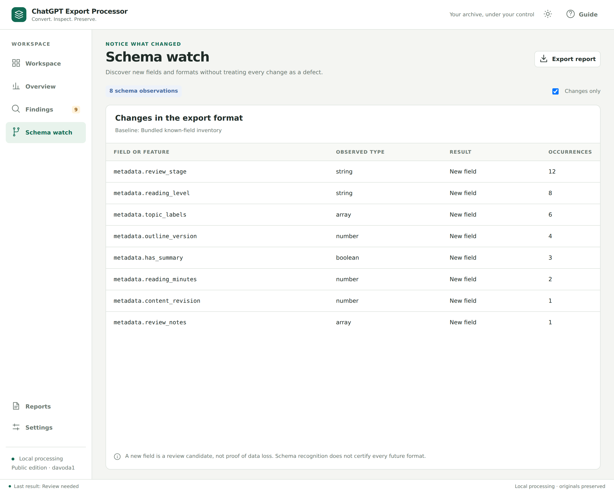

# Application screenshots

These screenshots show the running **ChatGPT Export Processor 1.0.0** desktop application. The same inspection is shown in light and dark appearance, with consistent framing at 1280 × 1030 logical pixels and 2× rendering for sharp text.

All conversation content, titles, and input names are synthetic. An intentionally empty reference and eight example metadata fields demonstrate how review candidates and schema observations appear. They do not represent a real person's export or a newly discovered ChatGPT format.

## Inspection overview

The overview separates preservation checks from review candidates and shows which original and converted inputs were available.

**Dark appearance**

**Light appearance**

## Findings and evidence

The selected observation identifies an empty Markdown reference already present in the original. Evidence is displayed as inert text, with tabs for actual, expected, original, and comparison views.

**Dark appearance**

**Light appearance**

## Schema watch

Schema watch lists fields and value types beyond the reviewed baseline. These example additions remain visible as review candidates rather than being treated automatically as data loss.

**Dark appearance**

**Light appearance**

[Return to the project README](../../README.md).
